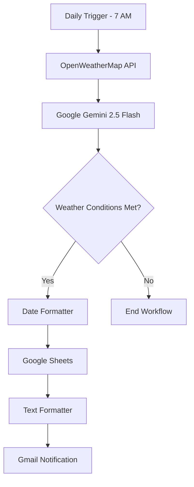

# Automation of Weather-Based Sales and Staffing Decisions

## Project Overview

An AI-powered business automation solution designed to help
retail businesses make informed daily decisions based on
weather conditions.

Developed for a demonstration company, Bayside Brews & Scoops,
a retail kiosk located in Miami, Florida, this project integrates
real-time weather data, generative AI, and workflow automation
to improve operational efficiency and business planning.

## Business Problem

Changing weather conditions directly affect customer demand,
product sales, foot traffic, and staffing requirements.

Retail managers often rely on manually checking weather
reports and adjusting daily operations accordingly.

These manual processes can lead to:

- Overstocking or understocking products
- Inefficient staffing decisions
- Increased operational costs
- Missed sales opportunities
- Delayed promotional activities
- Unnecessary administrative work

## The Solution

This project automates weather data retrieval and uses
Google Gemini AI to translate weather conditions into
actionable business recommendations.

The workflow provides product mix recommendations,
staffing suggestions, and weather-tailored promotional
messages to support daily business operations.

## Technology Stack

| Technology | Purpose |
|---|---|
| Zapier | Workflow automation and orchestration |
| OpenWeatherMap API | Real-time weather data retrieval |
| Google Gemini 2.5 Flash | AI-powered business recommendations |
| Webhooks by Zapier | REST API integration |
| Filter by Zapier | Conditional workflow execution |
| Formatter by Zapier | Date and text transformation |
| Google Sheets | Operational data logging |
| Gmail | Automated management notifications |
| Postman | API testing and validation |
| JSON | Workflow configuration and data exchange |

## Workflow Architecture

## How It Works

### 1. Scheduled Trigger - Zapier

The workflow is configured to automatically run every
morning at 7:00 AM, including weekends.

### 2. Weather Data Retrieval - OpenWeatherMap

An HTTP GET request retrieves current weather conditions
for Miami, Florida.

The workflow uses the following API endpoint:

https://api.openweathermap.org/data/2.5/weather

| Parameter | Value |
|---|---|
| q | Miami,FL,US |
| units | imperial |
| appid | YOUR_API_KEY |

The temperature and weather description are extracted
from the JSON response and passed to Google Gemini.

### 3. AI Business Analysis - Google Gemini

Gemini 2.5 Flash analyzes the weather conditions and
generates business recommendations across three areas:

**Product Mix Recommendations**

- Hot beverages
- Cold beverages
- Gelato
- Pastries

**Staffing Recommendations**

- Increase staffing
- Reduce staffing
- Maintain existing staffing levels

**Promotional Messaging**

- Two weather-specific promotional messages
- Maximum of 120 characters per message

The AI prompt is configured to return concise, actionable
recommendations in plain text.

### 4. Conditional Weather Filtering

The workflow continues when at least one of the
following conditions is met:

| Condition | Rule |
|---|---|
| High temperature | Greater than 91°F |
| Storm conditions | Description contains "storm" |
| Rain conditions | Description contains "rain" |

If none of these conditions are met, the workflow stops
before logging the results or sending an email.

### 5. Date Formatting

Formatter by Zapier standardizes the scheduled
date and time using the US/Eastern time zone.

### 6. Operational Logging - Google Sheets

Weather information and AI-generated recommendations
are recorded in a centralized spreadsheet.

| Field | Description |
|---|---|
| Date | Formatted scheduled date and time |
| Location | Miami, FL |
| Main Temp (F) | Current temperature in Fahrenheit |
| Weather Description | Current weather conditions |
| Daily Forecast Summary | AI-generated recommendations |

This provides a historical record of qualifying weather
conditions and operational recommendations.

### 7. Output Formatting

Formatter by Zapier removes HTML tags from the
AI-generated response to ensure clean, readable
email content.

### 8. Automated Email Notification - Gmail

The workflow delivers an operational snapshot directly
to the kiosk manager.

The email includes:

- Current temperature
- Weather conditions
- Product recommendations
- Staffing suggestions
- Promotional messages

## Key Features

- Automated daily weather monitoring
- REST API integration
- AI-powered business decision support
- Weather-based product recommendations
- Dynamic staffing recommendations
- Automated promotional content generation
- Conditional weather alerts
- Centralized operational data logging
- Automated management reporting
- Date and text transformation

## Example Use Case

Bayside Brews & Scoops is preparing for a hot summer
day in Miami, with a temperature of 95°F.

The workflow retrieves the current weather conditions
and sends the information to Google Gemini.

An example AI-generated recommendation could include:

**Product Strategy:**

Increase the availability of iced coffee, cold beverages,
and gelato to accommodate higher demand.

**Staffing Strategy:**

Consider adding an additional employee during peak
afternoon hours to support anticipated customer traffic.

**Promotional Messages:**

- Beat the Miami heat with an ice-cold coffee!
- Cool down today with your favorite gelato flavor!

The recommendations are recorded in Google Sheets
and emailed directly to the kiosk manager.

## Business Benefits

- Reduces manual weather monitoring
- Supports informed operational decisions
- Helps minimize unnecessary staffing expenses
- Supports improved inventory planning
- Helps reduce product waste
- Improves responsiveness to changing customer demand
- Supports targeted promotional activities
- Standardizes operational reporting
- Allows managers to focus on business operations

## Installation and Configuration

1. Download the JSON workflow configuration.
2. Log in to Zapier.
3. Import the workflow if supported by your account,
   or recreate the eight steps using the JSON configuration.
4. Configure the daily scheduled trigger for 7:00 AM.
5. Obtain an OpenWeatherMap API key.
6. Configure the webhook GET request.
7. Connect Google AI Studio and select Gemini 2.5 Flash.
8. Configure the AI system instructions and prompt.
9. Set up the conditional weather filter.
10. Configure the date formatter.
11. Connect Google Sheets and map the required fields.
12. Configure the text formatter.
13. Connect Gmail and update the recipient information.
14. Test the API request and workflow.
15. Activate the automation.

## Prerequisites

- Zapier account
- OpenWeatherMap API key
- Google AI Studio account
- Google Sheets account
- Gmail account
- Postman (optional for API testing)

## Security and Configuration

Users must configure their own API keys, account
connections, spreadsheet identifiers, and email recipients.

Never publish API keys or authentication credentials
in a public repository.

## Testing and Validation

The project demonstrates the following testing activities:

- REST API testing through Postman
- HTTP 200 response validation
- Weather data extraction
- AI prompt and response testing
- Conditional workflow configuration
- Google Sheets data mapping
- Email notification testing
- Output formatting validation

## Future Enhancements

- Hourly and multi-day weather forecast integration
- Humidity, wind speed, and precipitation analysis
- Historical sales data integration
- AI-powered demand forecasting
- Automated inventory replenishment recommendations
- Point-of-sale system integration
- Employee scheduling system integration
- Multi-location business support
- Automated social media promotions
- Business intelligence dashboards
- Advanced error handling and retry mechanisms

## Skills Demonstrated

- AI Automation
- Business Process Automation
- Prompt Engineering
- REST API Integration
- Webhook Integration
- JSON Data Mapping
- Conditional Logic
- Data Transformation
- Workflow Design and Orchestration
- API Testing with Postman
- Business Process Analysis
- Operational Decision Support
- Generative AI
- Low-Code/No-Code Development

## Project Status

Portfolio demonstration and proof of concept.

Developed as part of the TripleTen AI Automation
program to demonstrate how artificial intelligence
and workflow automation can support data-driven
retail operations and business decision-making.

The workflow provides recommendations rather than
directly modifying inventory or employee schedules.

## Author

**Mark Davis**

AI Automation | Business Systems | ERP & Systems Integration
